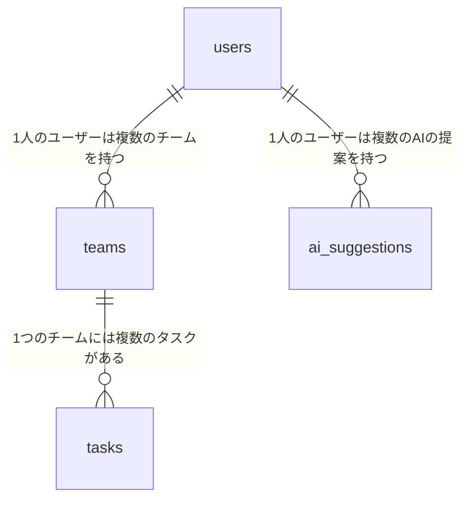

# task-morning-call

朝アプリを開くと、AI が今日のタスクの優先順位を提案してくれるタスク管理アプリです。

## 目次

- [要件定義](#要件定義)
- [機能一覧](#機能一覧)
- [画面設計](#画面設計)
- [DB設計](#db設計)
- [技術選定](#技術選定)
- [開発ルール](#開発ルール)
- [セットアップ](#セットアップ)

## 要件定義

| 項目 | 内容 |
|---|---|
| 誰が使うか | 上司と部下がいて、複数のチームを担当している人（まずは自分） |
| 困りごと | タスクが多く、何から始めるか判断に迷う／朝一番に何をすればいいか迷う |
| AIで楽にすること | 朝一番に、今日やるべきことをすぐ判断できる |
| このアプリならではの点 | 朝、アプリを開くとAIが今日の優先順位を提案してくれるタスク管理 |

### 決めたこと

- AI機能は「タスクの分解」ではなく「優先度の提案」にする
- 使うのは自分1人。チームは共有ではなく、タスクの「分類」として扱う
- 上司・部下との共有機能は、余裕ができたら追加する

## 機能一覧

### MVP（最初に作る範囲）

| 分類 | 機能 | 内容 |
|---|---|---|
| ユーザー | 登録・ログイン・ログアウト | 自分のタスクだけが見えるようにする |
| チーム | チームの登録・編集・削除 | 「Aチーム」「Bチーム」のような分類 |
| タスク | タスクの登録・編集・削除 | タイトル、メモ、期限、重要度、ステータス、チーム |
| タスク | タスク一覧 | チーム・ステータスで絞り込み、期限で並べ替え |
| タスク | ステータス変更 | 未着手 / 進行中 / 完了 の3段階（`enum` の練習） |
| タスク | 重要度 | 高 / 中 / 低（初期値は「中」） |
| AI | 今日の優先順位の提案 | ボタンを押すと、未完了（未着手・進行中）のタスクから、今日やる順番と理由をAIが提案する |
| AI | 提案の保存 | 提案を `ai_suggestions` に保存し、画面を開き直しても今日の最新の提案を表示する（API料金の節約） |

### AIに送る情報

- 送る：タイトル・予定日時・期限日時・重要度・ステータス・チーム名
- 送らない：メモ（description）
- 画面に「タイトルはAIに送られます」と書いておく

### 余裕ができたら追加する機能

| 機能 | 内容 |
|---|---|
| スマホ対応（レスポンシブ） | スマホでも見やすい画面にする |
| AIの利用回数の制限 | 1日に押せる回数を決めて、使いすぎを防ぐ |
| Dependabot | gem のアップデートを自動で知らせてもらう |
| エラー監視（Sentry など） | 本番でエラーが起きたら知らせてもらう |
| 提案の履歴 | 保存したAIの提案を、一覧で見返せる |
| 朝の自動提案 | 毎朝決まった時間に、AIが提案を作っておく（バックグラウンド処理） |
| 所要時間の入力 | 「30分」などを入れると、AIの提案がより正確になる |
| 通知 | 提案をメールやSlackで受け取る |
| タスクの分解 | 大きなタスクを、AIが小さなステップに分ける |
| 共有機能 | 上司や部下とタスクを共有する |

## 画面設計

### 画面一覧

| No | 画面 | 内容 |
|---|---|---|
| 1 | トップ | アプリの紹介、ログイン・新規登録へのリンク |
| 2 | 新規登録 | メールアドレス、パスワード |
| 3 | ログイン | メールアドレス、パスワード |
| 4 | 今日の画面 | 「AIに今日の優先順位を聞く」ボタン、提案の結果、進行中のタスク |
| 5 | タスク一覧 | 絞り込み（チーム・ステータス）、並べ替え（期限） |
| 6 | タスク登録・編集 | タイトル、メモ、予定日時、期限日時、重要度、ステータス、チーム |
| 7 | チーム一覧 | チームの登録・編集・削除（1画面でまとめて行う） |

### 画面の移動

```
[1. トップ]
   ├─→ [2. 新規登録] ─┐
   └─→ [3. ログイン] ─┴─→ [4. 今日の画面]  ← ログイン後の最初の画面
                              │
            ┌─────────────────┼─────────────────┐
            ↓                 ↓                 ↓
     [5. タスク一覧]   [6. タスク登録]    [7. チーム一覧]
            │
            └─→ [6. タスク編集]

※ 4・5・7 は、画面上部のメニューからいつでも移動できる
```

### 決めたこと

- ログイン後の最初の画面は「今日の画面」にする（要件「朝一番に何をするか即決できる」に合わせる）
- タスク詳細画面は作らない（一覧と編集画面で足りる）

## DB設計

### テーブルのつながり



- タスクは必ずどれかのチームに入る（チームなしのタスクは作らない）
- `tasks` には `user_id` を持たせない。`has_many :tasks, through: :teams` でユーザーからタスクを取り出す（`current_user.tasks`）

### users（ユーザー）

| カラム | 型 | 必須 | 説明 |
|---|---|---|---|
| email | string | ○ | メールアドレス（重複なし） |
| パスワード | string | ○ | 暗号化して保存（Rails 8 の認証機能で作る） |

### teams（チーム）

| カラム | 型 | 必須 | 説明 |
|---|---|---|---|
| user_id | references | ○ | どのユーザーのチームか |
| name | string | ○ | チーム名（同じユーザーの中で重複なし） |

### tasks（タスク）

| カラム | 型 | 必須 | 説明 |
|---|---|---|---|
| team_id | references | ○ | どのチームのタスクか |
| title | string | ○ | タイトル |
| description | text | | メモ |
| scheduled_at | datetime | | やる予定の日時（開始のみ） |
| due_at | datetime | | 期限の日時 |
| importance | integer | ○ | 重要度（`enum`：低 / 中 / 高、初期値は「中」） |
| status | integer | ○ | ステータス（`enum`：未着手 / 進行中 / 完了、初期値は「未着手」） |
| completed_at | datetime | | 完了にした日時（MVPではAIに送らない） |

### ai_suggestions（AIの提案）

| カラム | 型 | 必須 | 説明 |
|---|---|---|---|
| user_id | references | ○ | どのユーザーへの提案か |
| summary | text | ○ | 提案のまとめ（例：今日は報告資料に集中しましょう） |
| items | jsonb | ○ | タスクごとの順番と理由（AIが返したJSONをそのまま保存） |

`items` の例：

```json
[{ "task_id": 3, "order": 1, "reason": "期限が今日の17時" }]
```

※ どのテーブルにも `id`、`created_at`、`updated_at` が付く。

### 決めたこと

- 予定日時と期限日時を分けて持つ（どちらも必須ではない、日付と時間を入れる）
- 予定は開始の日時だけ（終わりの時間は持たない）
- タスクが残っているチームは削除できないようにする（`dependent: :restrict_with_error`）
- 完了にしたら `completed_at` に日時を入れる。完了から戻したら空にする

## 技術選定

| 項目 | 使うもの | メモ |
|---|---|---|
| 開発環境 | Docker（`compose.yaml`） | 公式が推奨するファイル名 |
| Ruby | 4.0.10 | 2026-11-22 時点の安定版の最新（4.1 はプレビュー版なので使わない） |
| Rails | 8.1.4.1 | 2026-11-22 時点の最新 |
| データベース | PostgreSQL | Docker のコンテナで動かす |
| 見た目 | Tailwind CSS ＋ daisyUI | daisyUI は Tailwind にボタンなどの部品を足すもの |
| ログイン | Rails 8 の標準機能（`bin/rails generate authentication`） | 新規登録画面は自分で作る |
| テスト | RSpec | |
| AI | OpenAI API | |
| バックグラウンド処理 | Solid Queue（Rails 8 の標準） | MVP では使わない。「改善」の段階で入れる |
| タイムゾーン | 東京（`config.time_zone = "Tokyo"`） | 「今日」がずれないように最初に設定する |
| 日本語化 | `rails-i18n` | エラーメッセージや enum（重要度・ステータス）を日本語で表示 |
| AIの返事の形 | OpenAI の Structured Outputs（JSON で返してもらう） | Ruby で扱いやすく、画面に表示しやすい |
| AIのテスト | WebMock（本物のAPIは呼ばない） | CIでお金がかからず、テストが安定する |
| 環境変数 | `.env.example` をリポジトリに置く | 必要な環境変数の一覧（値は書かない） |
| サンプルデータ | `db/seeds.rb` | チームとタスクを入れておき、すぐにAIの提案を試せる |
| AIレビュー | CodeRabbit | |
| デプロイ | Render | main にマージしたら自動デプロイ（CIが通ったときだけ） |
| タスク管理 | GitHub Projects | Issue をボードで管理する |

### 実装のときに気をつけること

- Ruby 4.0 は大きなバージョンアップなので、gem が対応していないことがある。そのときは調べて対応する

## 開発ルール

### 命名規則

| 対象 | ルール | 例 |
|---|---|---|
| モデル | 単数形・大文字始まり | `Task`、`Team` |
| テーブル | 複数形・小文字 | `tasks`、`teams` |
| コントローラー | 複数形 | `TasksController` |
| 日時のカラム | `_at` を付ける | `due_at`、`scheduled_at` |
| true/false を返すメソッド | `?` を付ける | `overdue?` |

### Lint・コードスタイル

- RuboCop（`rubocop-rails-omakase`。Rails 8 の標準）＋ `rubocop-rspec`
- Brakeman（セキュリティチェック。Rails 8 の標準）
- 最初は標準の設定のまま使い、困ったところだけ変える

### 開発フロー（git flow）

| ブランチ | 役割 | どこから作る → どこへマージ |
|---|---|---|
| `main` | 本番に反映する用（Render に自動デプロイ） | ― |
| `develop` | 開発したものをまとめる用 | ― |
| `feature/*` | 機能の開発 | develop → develop |
| `release/*` | 本番に出す前の最終確認・バージョン番号を付ける | develop → main と develop |
| `hotfix/*` | 本番のバグの緊急修正 | main → main と develop |

- ブランチ名：`feature/7-task-crud`、`release/1.0.0`、`hotfix/1.0.1-fix-login-error`
- main と develop には直接プッシュしない（GitHub の設定で禁止する）
- マージしたらブランチは削除する（GitHub の「Automatically delete head branches」を有効にする）

### マージの方法

| マージ | 方法 | 理由 |
|---|---|---|
| feature → develop | Squash and merge | feature は develop にしか入らない。1つの機能を1つのコミットにまとめて、履歴を見やすくする |
| release / hotfix → main・develop | Create a merge commit | 2か所（main と develop）に入るので、同じコミットを共有させて履歴のずれを防ぐ |

### バージョン番号

`1.0.0` の形（大きな変更.機能の追加.バグ修正）

### コミットメッセージ

`種類: 内容` の形（Conventional Commits）。内容は日本語。

| 種類 | 使うとき | 例 |
|---|---|---|
| `feat` | 機能の追加 | `feat: タスクの登録機能を追加` |
| `fix` | バグ修正 | `fix: 期限が空のときのエラーを修正` |
| `test` | テストの追加 | `test: Task モデルのテストを追加` |
| `refactor` | 動きを変えずにコードを整理 | `refactor: AIの処理を Service クラスに移動` |
| `docs` | ドキュメントの変更 | `docs: README にセットアップ手順を追加` |
| `chore` | 設定などの雑務 | `chore: RuboCop の設定を変更` |

### Issue のテンプレート

```markdown
## 概要
何をするか（1〜2行）

## やること
- [ ] 作業1
- [ ] 作業2

## 完了条件
- どうなったら終わりか

## 参考
```

### PR のテンプレート

```markdown
## 関連 Issue
close #番号

## 変更内容

## 確認方法

## スクリーンショット（画面の変更があるとき）
```

### CI / CD

- CI（GitHub Actions）：RuboCop・Brakeman・RSpec を PR ごとに自動で動かす
- AIレビュー：CodeRabbit（PR に自動でレビューのコメントが付く）
- CD：main にマージしたら Render に自動デプロイ

## セットアップ

（No.7 で書く）
